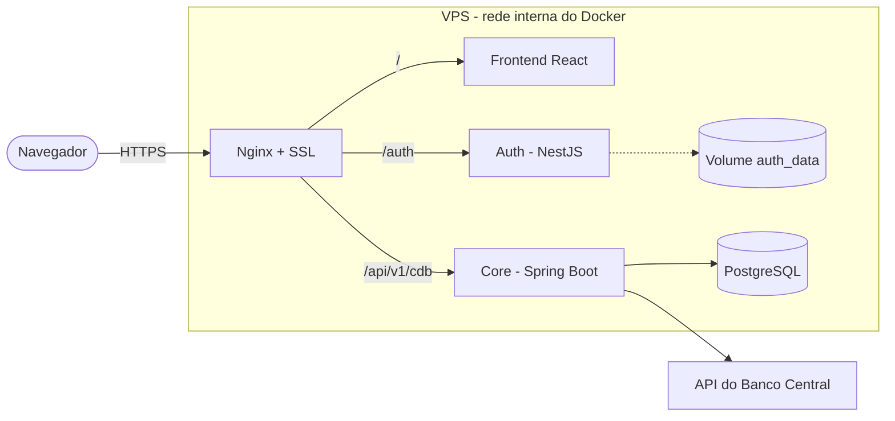

# Liquidador de CDB


**Demo em produção:** https://acmors-developer.com.br

Resumo: Um cliente tem vários CDBs aplicados em datas diferentes, quer sacar uma parte e o sistema te fala de quais lotes tirar pra pagar menos imposto. O rendimento é calculado com o CDI real do Banco Central, dia a dia.

---

## Sobre o projeto

Todo mundo que investe em CDB vai aportando aos poucos. Cada aporte vira um lote, e cada lote tem a sua própria tributação, porque IOF e IR dependem de quantos dias o dinheiro ficou aplicado.

Na prática fica assim:

- Lote de 12 dias: paga IOF (que pode comer até 96% do rendimento) e mais 22,5% de IR
- Lote de 2 anos: não paga IOF e o IR cai pra 15%

Se você pede um resgate de R$ 2.000 e o sistema simplesmente vai tirando na ordem que você aplicou, sem olhar quanto cada lote custa de imposto, você pode acabar mexendo justamente no lote mais caro, ou seja, imposto maior sobre o lucro.

A ideia foi criar algo que faça a conta direito antes de resgatar.

## Como funciona

1. Puxa a série diária do CDI direto da API SGS do Banco Central (série 12)
2. Pra cada lote, calcula-se o rendimento acumulado, o IOF, o IR e quanto sobra líquido
3. Ordena-se os lotes do mais barato pro mais caro em imposto
4. Vai consumindo nessa ordem até bater o valor líquido que o usuário pediu
5. Mostra na tela o detalhe de cada lote usado, com quanto de imposto saiu de cada um

---

## Arquitetura



| Serviço | Stack | O que faz |
|---|---|---|
| `liquidador-resgate-RF` | Java 21, Spring Boot 4, JPA | Toda a parte de cálculo: rendimento, IOF, IR e o resgate |
| `auth-service` | NestJS, TypeScript, bcrypt, JWT | Cadastro, login, regra de senha e recuperação por código no e-mail |
| `frontend` | React 19, Vite, Tailwind | Tela com cara de app de banco genérico |
| `postgres` | PostgreSQL 16 | Guarda os lotes |
| infra | Docker Compose, Nginx, Let's Encrypt, GitHub Actions | Todo push na main sobe sozinho na VPS |

Nota-se que há uma separação entre core da aplicação e autenticação. O Java cuida só de dinheiro, o Nest cuida só de usuário e os dois conversam pelo JWT.

---

## Algumas decisões e desafios que foram resolvidos no caminho

### Dinheiro é BigDecimal e ponto
Sem `double` ou `float` em cálculo financeiro. Ponto flutuante pode errar centavos e como o objetivo é simular um ambiente próximo a um banco, cada centavo errado é problema. Rendimento, IOF e IR são todos calculados com `BigDecimal`.

### CDI de verdade, não taxa inventada
Não há um chute de uma taxa anual fixa. O sistema pega o CDI de cada dia que o dinheiro ficou aplicado e vai capitalizando em cima do percentual do lote (110% do CDI, por exemplo).

### Cache de 24h, sem Redis
O CDI só muda uma vez por dia então não tinha por que bater na API do BACEN a cada requisição. Optei por utilizar o `@Cacheable` na consulta e um `@Scheduled` com `@CacheEvict` que limpa tudo a cada 24h.

### A falha de IDOR que eu mesmo tinha deixado
A primeira versão tinha a rota `GET /carteira/{clienteId}`. Funcionava mas qualquer pessoa logada podia trocar o número na URL e ver a carteira de outra.

Corrigi assim: o Nest gera o JWT com o `clientId` dentro, o Spring valida o token num filtro (`JwtAuthFilter`) e tira o ID de lá. A rota virou só `GET /carteira`, e o servidor devolve os dados de quem tá logado e pronto.

No meio disso ainda teve um bug bobo: o Nest gravava `clientId` no token e o Java procurava `clienteId`. Uma letra e tudo dava 401.

### Race condition na hora de subir os containers
Quando coloquei o PostgreSQL o Spring subia antes do banco estar pronto, não conseguia conectar e caía. No navegador aparecia só "não foi possível consultar a custódia" (bater na API do BACEN) e o Nginx devolvia 502.

O `depends_on` comum não resolve, porque ele só espera o container do banco iniciar, não espera o banco aceitar conexão. Resolvi com healthcheck:

```yaml
postgres:
  healthcheck:
    test: ["CMD-SHELL", "pg_isready -U postgres -d cdb_database"]
    interval: 3s
    retries: 10

cdb-core:
  depends_on:
    postgres:
      condition: service_healthy
```

Agora o Java só sobe depois que o Postgres fala que tá pronto.

### Banco sem porta aberta
O Postgres não expõe a 5432 pra fora. Só os containers da rede interna do Docker falam com ele. Se deixasse aberto em pouco tempo ia ter robô tentando senha, o que iria sobrecarregar a VPS, impossibilitando o acesso a aplicação.

### Nada de segredo no código
`JWT_SECRET`, senha do banco e credencial de e-mail ficam no GitHub Secrets. No deploy o Actions gera o `.env` direto na VPS. No repositório só tem `${JWT_SECRET}`.

### Senha fraca não passa
Mínimo de 8 caracteres com maiúscula, minúscula, número e caractere especial. Também bloqueio caractere repetido (`aaa`) e sequência óbvia (`123`, `987`). A senha é salva com bcrypt.

---

## As regras de imposto

### IOF (Decreto 6.306/2007)
Só incide nos primeiros 29 dias, em cima do rendimento.

| Dias | IOF | Dias | IOF | Dias | IOF |
|:---:|:---:|:---:|:---:|:---:|:---:|
| 1 | 96% | 10 | 66% | 20 | 33% |
| 5 | 83% | 15 | 50% | 30+ | **0%** |

### IR (Lei 11.033/2004)

| Tempo aplicado | Alíquota |
|---|:---:|
| Até 180 dias | 22,5% |
| 181 a 360 dias | 20% |
| 361 a 720 dias | 17,5% |
| Mais de 720 dias | 15% |

---

## Endpoints

As rotas do core precisam do header `Authorization: Bearer <token>`.

| Método | Rota | O que faz |
|---|---|---|
| `POST` | `/auth/Cadastro` | Cria a conta |
| `POST` | `/auth/login` | Devolve o JWT |
| `POST` | `/auth/esqueci-senha` | Manda um código pro e-mail (vale 15min) |
| `POST` | `/auth/redefinir-senha` | Troca a senha usando o código |
| `GET` | `/api/v1/cdb/carteira` | Lista os lotes com rendimento e imposto |
| `POST` | `/api/v1/cdb/aportes?valor=&diasAtras=&percentualCdi=` | Cria um aporte |
| `GET` | `/api/v1/cdb/simular?valor=` | Simula o resgate pagando menos imposto |

---

## Como rodar o projeto

É necessário apenas o Docker e Docker Compose.

```bash
git clone https://github.com/acmors/liquidador_resgate_renda-fixa.git
cd liquidador_resgate_renda-fixa
```

Cria um `.env` na raiz:

```env
JWT_SECRET=uma_chave_com_pelo_menos_32_caracteres
DB_PASSWORD=senha_do_postgres
EMAIL_USER=seu_email@gmail.com
EMAIL_PASS=senha_de_app_do_gmail
VITE_AUTH_API_URL=
VITE_JAVA_API_URL=/api/v1/cdb
```

E sobe tudo:

```bash
docker compose up -d --build
```

Depois é só abrir `http://localhost`, criar uma conta e clicar em **Carga Demo** pra gerar três lotes de exemplo.

---

## Desenvolvido por:

**Marcos Antonio**, desenvolvedor back-end

[LinkedIn](https://www.linkedin.com/in/marcos-antonioo/) · [GitHub](https://github.com/acmors)

Se achou algum erro na regra de imposto ou tem ideia do que colocar aqui, abre uma issue ou me chama no LinkedIn.
